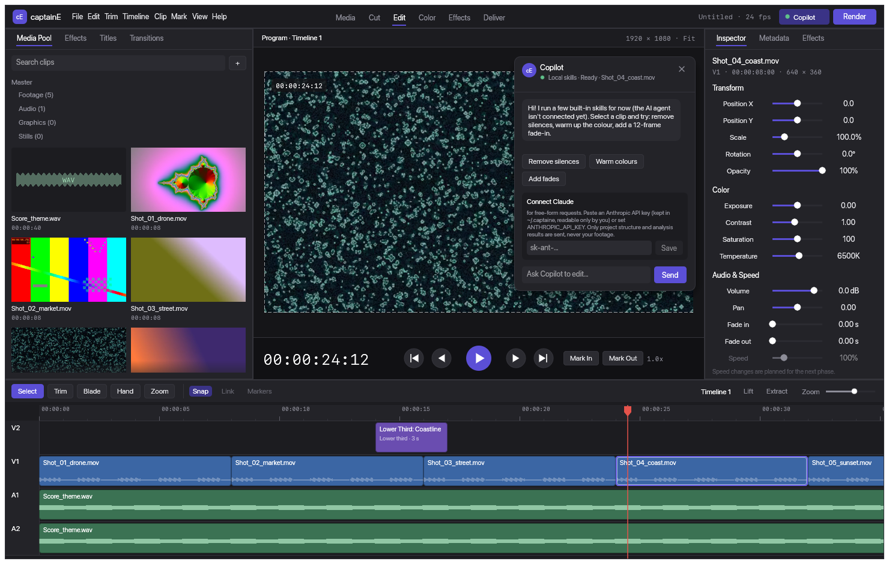
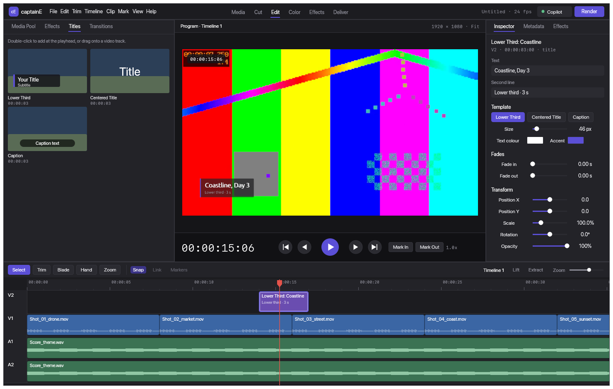

# 15 — The editor window





Run it:

```
cargo run --release -p captaine-app                 # reopens your last project, or makes ~/Movies/captainE/Untitled.captaine.json
cargo run --release -p captaine-app -- my.captaine.json
```

Always use `--release`: the compositor is CPU code and a debug build is far too slow to play.

## Toolkit decision

**egui (eframe 0.36).** All-Rust, so the UI calls the engine crates directly with no bridge, and the timeline and
viewer are custom-painted. Tests render the whole window offscreen through `egui_kittest`, which is also how the
screenshot above is produced. Qt/QML (docs/10) stays the fallback if egui's text and accessibility limits start to hurt.

## What follows the design mockup

| Area | State |
|---|---|
| Top bar: menus, page tabs, project name and fps, Copilot toggle, Render | Done. Only **Edit** and **Deliver** (opens export) are real pages; Media, Cut, Color, Effects say they are planned |
| Media pool: bins, search, thumbnails, drag to timeline, double-click to append, drop files from Finder | Done. Titles tab works; Effects and Transitions tabs are placeholders (not in the engine yet) |
| Program viewer: picture, timecode chip, dashed outline of the selected clip's transform, transport, Mark In/Out | Done |
| Inspector: Transform, Color, Audio, Blend, Metadata | Done and live. Drag a slider and it is one undo step. **Speed** is shown disabled (no speed changes in the engine yet) |
| Timeline: tracks, clips with waveforms, ruler, playhead, snapping, zoom/scroll, Select/Trim/Blade/Hand/Zoom, Lift, Extract | Done. **Link** and **Markers** are shown disabled |
| Copilot panel | **Done, two modes.** With an Anthropic API key (paste it in the panel, or set `ANTHROPIC_API_KEY`) it is the Claude agent of docs/08: free-form requests, live tool progress, one suggestion to Preview / Apply / Discard, follow-ups that build on it. Without a key it runs built-in local skills (remove silences, colour, fades) so it still works offline. Not tried against the live API from this machine (no key here); the loop is tested end to end with a scripted model |
| Title clips (the purple "Lower Third" in the mockup) | **Done.** Lower Third, Centered and Caption templates; Titles tab, inspector (text, size, colours, fades, transform), move/trim/cut like clips, burned into exports |
| Keyframe diamonds in the inspector | Not built (no keyframes in the engine yet) |

## Editing, in the window

Drag a clip to move it (overwrites what it lands on; snaps to the playhead, other clips and marks), drag a clip
edge to ripple-trim, `B` then click to cut, `⌘B` to cut at the playhead, `⌫` lift, `⇧⌫` extract, `I`/`O` marks (lift
and extract then act on the marked range), `⌘Z`/`⇧⌘Z`, `Space`/`J`/`K`/`L` to play and shuttle, `←`/`→` to step.
`?` lists every shortcut. Click a track name to hide or mute it. Every change is saved automatically to the project
file (it is the operation log, so undo survives restarts).

## How it plays

Preview frames are rendered on a worker thread at up to 960 px wide and only the newest requested frame is
rendered, so scrubbing never queues up. Sound comes from the mixer through cpal; the number of frames the speakers
have actually played is the clock, so the picture follows the sound. Without an output device it falls back to the
wall clock. Proxies (`captaine proxy`) are used automatically for preview when they exist.

## Known limits

- Preview rendering is CPU-bound. Heavy stacks of 4K layers will drop frames; proxies and the planned GPU
  compositor are the fix.
- The window has no undo-history list, no multi-selection and no ripple/roll/slide drag modes yet (the gestures
  exist in `ops::edit` and the CLI).
- Fonts: it uses the macOS system fonts when found, otherwise egui's built-ins.
