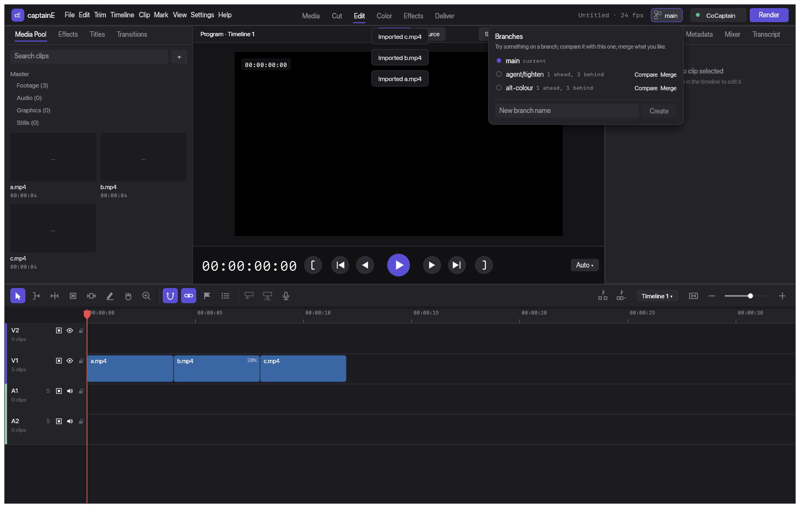
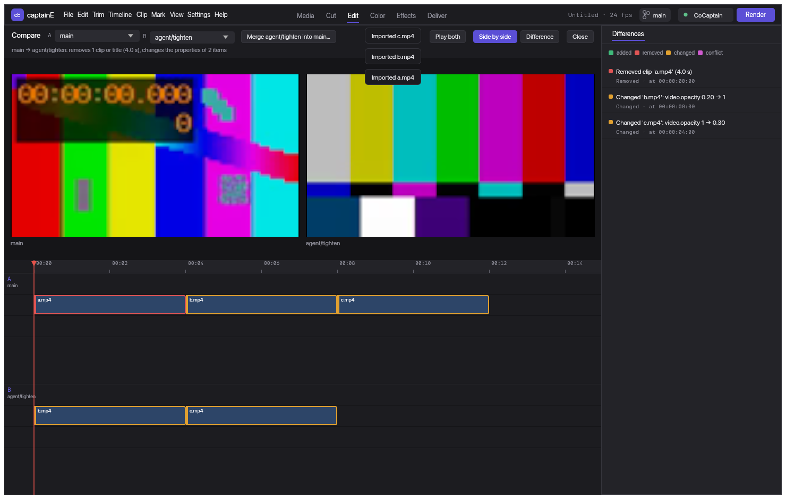
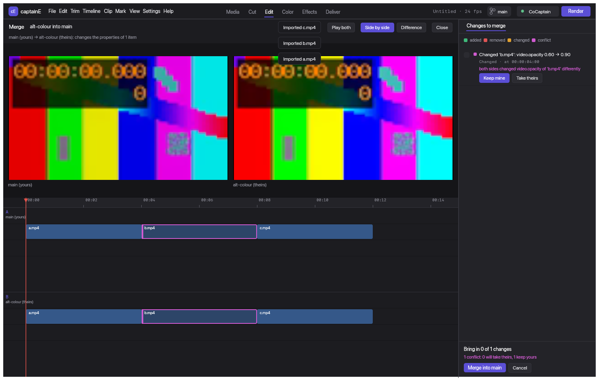

# 16 — Phase 4 status (branches and compare)

Phase 4 of [the roadmap](12-roadmap.md) is built: history, branches, compare, three-way merge, and CoCaptain working
on its own branch. The design is [07](07-branching-and-versioning.md); this records what was built and how.

## Exit criteria

| Criterion (docs/12) | Result |
|---|---|
| Agent branch → compare → partial merge works | `crates/app/tests/branches.rs`: CoCaptain's suggestion is saved on `agent/…` (your timeline untouched), you open the review screen, untick a change, merge: only the chosen change comes in |
| History survives crashes | Every edit is written to the project file within 0.6 s (atomic write: temp file then rename); branch actions save at once. A crash can lose the last fraction of a second, never a commit |
| Diffs are readable | Each change is a sentence ("Trimmed 'intro': duration 4.0 s → 3.2 s") and each branch/commit has a summary ("removes 1 clip (4.0 s), changes the properties of 2 items") |

About 45 tests cover this phase (27 in `vcs`, 11 for the session, 7 through the window), including three fuzzers: random states → ops (180 pairs), random edits on both sides of
a merge (120 + 80 + 600 pairs); the whole project now has about 215 tests.

## How it works

- **Commits.** A commit is a list of ops on top of its parent, hashed with BLAKE3 (`crates/vcs/src/repo.rs`). State at
  any commit is a replay, cached. Branches are names pointing at commits. A merge commit has two parents; its ops turn
  the first parent's state into the merge result.
- **Working edits.** What you do between commits stays in the editor (so undo works) and is saved in the project file.
  Switching branch, merging and saving a CoCaptain edit commit it first, so nothing is lost. Undo can go back past a
  commit; the next commit then records the difference.
- **Diff** matches by stable id and classifies each thing as added, removed, moved (another track or another place in
  the order), trimmed, modified (with the field list), or *shifted*, meaning only pushed along by a ripple, which is
  not listed as an edit.
- **Merge** is three-way on states (base = nearest common ancestor), not on op logs, so a ripple delete on one side
  does not misplace anything on the other:
  - their changes are applied to ours one at a time, inserted next to the nearest neighbour we have;
  - a thing both sides changed is merged **field by field**; only the same field set to different values conflicts;
  - delete-vs-change conflicts; two cuts of the same clip conflict (both change its length);
  - gaps are real items, so a lift brings its gap with it and skipping a change leaves no stray gap;
  - each change can be taken or skipped; conflicts default to *ours* and are decided per change;
  - the result is checked to be a valid project and converted to ordinary ops (`sync_ops`), which are themselves
    verified by replay. A merge that cannot be expressed is refused, never guessed.
- **After a merge** the next merge of the same branch offers only the new work (the base moves up), including the
  case where the branch kept going after being merged.
- **CoCaptain** saves a suggestion of three or more steps on its own `agent/<task>` branch by default (small ones are
  applied directly); the panel then offers **Review agent/…**, which opens the merge screen. Author on those commits is
  `CoCaptain`.
- **Project files** moved to version 2 (repo + working edits). Version 1 files open as one branch, `main`, with the old
  log as uncommitted edits, and are upgraded on the next save.

## In the window

Branch pill in the top bar (menu: switch, create, compare, merge, commit); a **History** tab in the inspector (commit
list with authors, times and summaries; commit box); the **Compare** screen (two timelines with changes colour-coded,
two viewers side by side or as a difference picture, change list, play both versions); the same screen as the **Merge**
review with a checkbox per change and Keep mine / Take theirs for conflicts.

## Command line

`captaine branch | checkout | commit | log | diff | merge` (`merge --dry-run`, `--conflicts theirs`, `--skip <name>`).

## Known limits

- Items on *different* tracks keep their absolute times when another track ripples: a title placed at 50 s on V2 does not
  slide when the other branch ripple-deletes something on V1. (Ripple across all tracks, `extract_range`, stays in sync.)
- Renaming a timeline or a track has no op, so a branch that renames one cannot be merged or synced (it says so).
- Branches and commits are local: no remotes, push/pull, tags or squash yet. Deleting a branch leaves its commits in
  the file (no garbage collection).
- Media is referenced by path; versions of the *files* are not tracked.
- The History tab is a list, not a drawn graph; merges show as commits with two parents.
- Compare lines up the two timelines by time, not by content; very long timelines are not virtualised.
