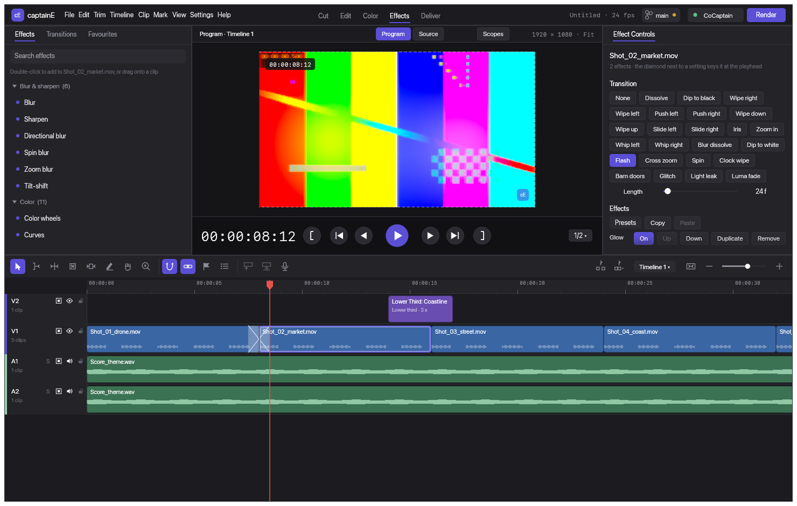

# 20 — The Effects page and the effects library

Built 2026-10-16. What Adobe and Blackmagic ship, what captainE now has, and what is still missing.

## What the yardsticks contain

**Adobe Premiere (version 26.0, from Adobe's own "List of effects and transitions" page, read 2026-10-16).**
Video effects in 15 categories: Adjust (Extract, Levels, Lighting Effects, ProcAmp), Blur & Sharpen (Bokeh,
Compound, Directional, Focus, Gaussian blur, Sharpen, Unsharp Mask), Color Correction (CDL, Brightness & Contrast,
the Lumetri panel, Tint, Video Limiter, Vignette), Distort (Corner Pin, Lens Distortion, Mirror, Spherize, Turbulent
Displace, Twirl, stabiliser, Wave Warp), Generate (4-Color Gradient), Image Control (Black & White, Channel Mix,
Color Pass, Color Replace, Gamma Correction, Invert, Rounded Crop), Keying (Alpha Adjust, Color Key, Luma Key, Track
Matte, Ultra Key), Lights & Glows (Echo Glow, Edge Glow, Glint, Light Leaks, RGB Split, Volumetric Rays, glow),
Noise & Grain, Perspective (Basic 3D, Drop Shadow, Long Shadow), Stylize (Brush Strokes, Color Emboss, Find Edges,
Mosaic, Posterize, Roughen Edges, Strobe Light), Time (Posterize Time), Transform (3D Rotate, Camera Shake, Flip,
Offset, Spin, Wiggle...), Utility (Clone, Stroke, timecode burn-in). Video transitions in ten groups (Dissolve,
Lights & Blurs, Grunge & Distort, Slide, Wipe, Animation, Transformers...), about 80 in all, many of them recent
additions bought in from a plug-in maker.

**Blackmagic DaVinci Resolve.** The Edit page's Effects Library holds Video Transitions, Titles, Generators and the
Resolve FX plug-ins (also on the Fusion and Color pages). Resolve FX are grouped as Blur, Color, Generate, Light (Aperture
Diffraction, Glow, Lens Flare, Lens Reflections, Light Rays), Refine, Repair, Sharpen, Stylize (Abstraction, Blanking
Fill, Drop Shadow, Edge Detect, Emboss, Halftone, Mirrors, Pencil Sketch, Prism Blur, Scanlines, Stop Motion, Tilt-Shift,
Vignette, Watercolor...), Temporal, Texture (Film Grain, Analog Damage, Film Damage), Transform (Camera Shake, Video
Collage...) and Warp (Dent, Lens Distortion, Ripples, Vortex, Waviness, Warper). Category and effect names are from
Resolve 18–19 manuals and may differ between versions. The Fusion page is a separate node compositor; that is
Phase 6 here, not this page.

Both products put the same three things on their effects screen: **a searchable library by category** (with
favourites), **the viewer and timeline**, and **controls for the selected clip with a keyframe on every setting**.
That is what the captainE Effects page is.

## What captainE has now

60 picture effects in 11 categories (plus 7 sound effects), 24 transitions. Every effect was written for captainE
from textbook methods; named methods are cited in `crates/render/src/library.rs` (bilateral filter, Sobel, Kuwahara
with summed-area tables, Heckbert's projective mapping). Names are our own where the vendors' are distinctive
("Turbulence", "Bulge", "Analog tape", "Low frame rate", "Color isolate", "3D tilt").

| Category | Effects |
|---|---|
| Blur & sharpen | Blur, Sharpen, Directional blur, Spin blur, Zoom blur, Tilt-shift |
| Color | Color wheels, Curves, Hue/Sat/Lum, LUT, Brightness & contrast, Levels, Black & white, Color isolate, Channel mixer, Duotone, Invert |
| Distort | Lens distortion, Bulge, Twirl, Wave, Turbulence, Corner pin, Mirror |
| Generate | Four-colour gradient, Grid |
| Keying & masks | Chroma key (CoCaptain's key colour is refined to the real backdrop in the shot, like an eyedropper, with the reach scaled to how colourful it is), Luma key, Mask (rectangle, ellipse, drawn), Subject matte (AI) |
| Light & glow | Glow, Lens flare, Light rays, Light leak, Chromatic aberration (RGB split) |
| Noise, grain & texture | Film grain, Denoise, Old film, Analog tape |
| Perspective | Drop shadow, 3D tilt |
| Stylize | Find edges, Emboss, Halftone, Scanlines, Cartoon, Pencil sketch, Oil paint, Glitch, Pixelate, Posterize, Threshold, Vignette |
| Time | Strobe, Low frame rate |
| Transform | Crop (with rounded corners), Offset, Tile, Camera shake, Letterbox |

Transitions: dissolve, dip to black, dip to white, blur dissolve, flash, light leak, luma fade, wipes (four
directions), clock wipe, barn doors, iris, push and slide (left/right), zoom in, cross zoom, spin, glitch, whip
left/right.

**Keyframes on any effect setting.** A setting is animated as the property `fx.<kind>.<setting>` (the second effect
of the same kind is `fx.<kind>#2.<setting>`), so keys stay with their effect when the stack is reordered, and go
when the last effect of that kind is removed. The renderer evaluates them per frame. Time-based effects (wave,
turbulence, shake, glitch, light leak, old film, analog, strobe, grain) get the clip's own time, so they move in a
still frame too.

**The page.** Library on the left: Effects / Transitions / Favourites tabs, search across names, descriptions and
categories, folding categories, a star for favourites (kept in preferences), and a hover card with a live preview of
the effect on the frame in the viewer. Double-click to add to the selected clip or title, right-click for
"Apply to selected", or drag onto a clip (effects) or onto a cut (transitions); the target is outlined while
dragging. Effect Controls on the right: the selected clip's transition and its effect stack, a keyframe diamond
next to every setting, presets, copy/paste, reorder. The Edit page's pool tabs "Effects" and "Transitions" show the
same library.

**CoCaptain** knows the whole library: the effects and transitions tool descriptions are generated from the model's
catalogue (category, description, every setting with its range and default), so a new effect reaches CoCaptain the
moment it exists. `set_keyframes` takes effect settings and checks the effect is there and the values are in range.
A live test asks CoCaptain for every effect in plain words (`crates/app/examples/cocaptain_effects_eval.rs`).

## Tests

- `crates/render/src/library.rs`: every library effect changes a picture, neutral settings leave it alone, animated
  effects move with time (and still ones do not), and effects do what their names say.
- `crates/render/tests/render.rs`: all 24 transitions start on the old picture and end on the new one, each new one
  checked for its own look; keyframed effect settings, low frame rate and drop shadow through the renderer.
- `crates/agent/tests/color_tools.rs`: every effect through CoCaptain's own tools on rendered footage; effect
  keyframes through `set_keyframes`; every transition key; the auto-picked chroma key on a dull green backdrop.
- Live: `cocaptain_effects_eval` on the PushDay reel, 69 requests (every effect asked in plain words, editing,
  animating, removing and stacking effects, the ten new transitions). Third run 68 of 69, and the last one passed
  once its check measured the visible picture (CoCaptain had allowed for bars already in the reel). Fixed along
  the way: CoCaptain's chroma key colour is refined to the real backdrop; blur and sharpen did nothing at preview
  sizes. Reports: `~/project/gym-reels/captaine/cocaptain_logs/effects_eval-*.md`.
- `crates/app/tests/interaction.rs`: the Effects page by mouse (search, double-click, right-click, drag onto a clip,
  keyframe diamond, transition, favourites, the Edit page pool).

## Tools for checking by eye and speed

- `cargo run --release -p captaine-render --example fx_sheet -- <video> <out.png> [seconds]`: a contact sheet of
  every effect on one frame of your footage.
- `cargo run --release -p captaine-render --example fx_bench [height]`: milliseconds per effect on one frame. At
  1080p most take 5–20 ms; spin, zoom and directional blur and light rays (two composed passes of up to 8 taps)
  about 35–60 ms; denoise about 35 ms.

## Not built yet

- Echo / trails (needs earlier frames), track matte, displacement maps, morph cut, page peel and 3D transitions.
- Per-transition settings (direction, softness, colour of a dip).
- Effects run on the CPU; heavy ones (denoise, oil paint) are slow at 4K. A GPU path is Phase 1's open item.
- Keyframe curves are edited by diamonds and values; there is no graph editor (Phase 6).
